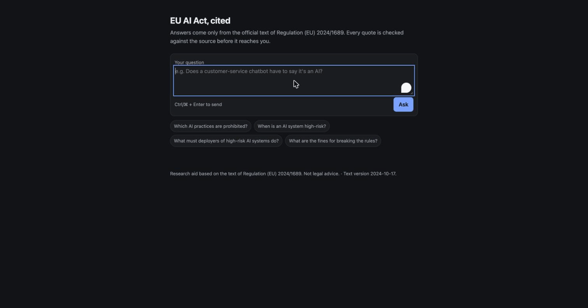
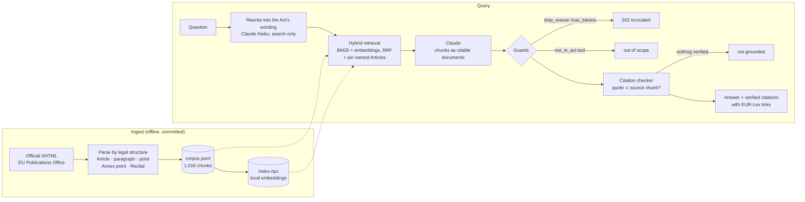

<div align="center">

# EU AI Act, cited

**Ask the EU AI Act a question. Get an answer whose every quote has been checked against the official text.**

[](https://github.com/Finjineersdev/eu-ai-act-rag/actions/workflows/ci.yml)


[](LICENSE)

</div>

<p align="center"></p>

## Why

The EU AI Act applies to anyone who puts AI systems on the EU market, including US, UK and
remote-first companies. Product and legal teams keep asking the same questions:
*is our feature high-risk? what do we owe as a deployer? when does this apply?* The answers are
spread across 113 Articles, 13 Annexes and 180 Recitals.

Generic chatbots answer confidently and cite Articles that don't say what they claim. In a legal
context, a made-up citation is worse than no answer. This service is built around one rule:
**it never shows a citation it hasn't verified.**

## How it works



1. **Ingest** parses the official text into chunks that follow the law's own structure, so every
   citation is precise ("Article 5(1)(f)", "Annex III, point 4"). Each chunk's offsets are checked
   against its source: `source[start:end] == chunk`, or the build fails.
2. **Query rewrite.** People say "employers" and "banned"; the Act says "workplace" and "prohibited".
   Claude Haiku rewrites the question in the Act's vocabulary, and the rewrite is used only to
   search. Without it, "Can employers use emotion recognition on their staff?" ranked Article 5(1)(f)
   90th; with it, 2nd. If the rewrite call fails, search uses the original question.
3. **Retrieval** combines keyword search (BM25, good at "Article 50") with local embeddings (good at
   paraphrases), merged with Reciprocal Rank Fusion. Recitals are capped so the Articles that
   carry obligations aren't crowded out.
4. **Generation** sends each chunk to Claude as a separate citable document (Anthropic Citations).
5. **Verification** checks every returned quote against the chunk it cites. A claim whose quotes
   don't match is removed. If nothing survives, the answer says the text doesn't cover it.

## What it refuses to do

| Situation | Behaviour |
|---|---|
| A quote doesn't appear in the cited chunk | The claim is removed before the response leaves the server |
| Nothing in the answer can be verified | `status: "not_grounded"` with a fixed message, no guessing |
| The question needs another law (GDPR rules, US law) | `status: "not_in_act"` |
| The reply hit `max_tokens` | HTTP 502 `truncated`, never a half answer |
| The model declines | Server-side fallback to another model; if all decline, HTTP 502 `refused` |
| The user insists on a wrong Article | The answer changes only if they point to text (measured below) |

## Evals

Measured on 2026-11-23 with `claude-opus-5-5` ([full report](evals/results/answers.md)):

| Metric | Result |
|---|---|
| Citations the model produced that matched the source text | **100%** (240/240) |
| Answers citing the Article the question is about | **100%** (20/20) |
| Out-of-scope questions refused (GDPR rules, US law, tax) | **100%** (5/5) |
| Held the correct Article through two rounds of user pushback | **100%** (5/5) |

Retrieval, without the query rewrite, runs on every push ([report](evals/results/retrieval.md)):

| Questions | recall@5 | recall@10 |
|---|---|---|
| Name an Article ("What does Article 50 require?") | 100% | 100% |
| Plain language ("Can employers use emotion recognition on staff?") | 69% | 94% |
| All 25 with an expected answer | 90% | 98% |

Recall counts whether the right Article or Annex is retrieved; the answer eval is where paragraph-level
precision shows. Pushback is graded by `claude-haiku-5-5` against a one-word rubric, and the opening
of every final reply is in the report so the grading can be checked by eye.

Golden set: [`evals/golden.jsonl`](evals/golden.jsonl), 30 hand-labelled questions (direct lookups,
plain-language paraphrases, multi-article questions, out-of-scope questions, and two-round pushback
cases). Every expected Article was checked against the text. Retrieval evals run on every push in CI;
answer evals run on demand ([workflow](.github/workflows/evals.yml)).

## Run it

```bash
cp .env.example .env          # add your ANTHROPIC_API_KEY
docker compose up --build     # http://localhost:8000
```

Without Docker:

```bash
uv sync
uv run uvicorn actrag.api:app --reload
```

Run the tests and evals:

```bash
uv run pytest                              # 48 tests, no network or API key
uv run python evals/run.py --retrieval     # free
uv run python evals/run.py --answers       # calls Claude
```

Rebuild the corpus from the official source (optional; the parsed corpus is committed):

```bash
uv run python -m actrag.ingest && uv run python -m actrag.index
```

## API

```bash
curl -s localhost:8000/ask -H 'content-type: application/json' \
  -d '{"question": "Does a customer-service chatbot have to say it is an AI?"}'
```

```json
{
  "status": "answered",
  "answer": "**Generally yes.** If the chatbot talks directly with customers, the AI Act requires that people be told they're dealing with an AI, unless that's already obvious. …",
  "citations": [
    {
      "ref": "Article 50(1)",
      "quote": "Providers shall ensure that AI systems intended to interact directly with natural persons are designed and developed in such a way that the natural persons concerned are informed that they are interacting with an AI system, unless this is obvious from the point of view of a natural person who is reasonably well-informed, observant and circumspect, taking into account the circumstances and the context of use.",
      "url": "https://eur-lex.europa.eu/eli/reg/2024/1689/oj/eng#art_50"
    },
    "…"
  ],
  "model": "claude-opus-5-5",
  "corpus_date": "2024-10-17",
  "disclaimer": "Research aid based on the text of Regulation (EU) 2024/1689. Not legal advice."
}
```

| Endpoint | |
|---|---|
| `POST /ask` | `{question, history?}` (history: up to 4 plain-text turns) → `{status, answer, citations[{ref, quote, url}], model, corpus_date, disclaimer}` |
| `GET /health` | `{status, corpus_date, chunks}` |
| `GET /` | the web page |

## Design decisions

Full design: [`docs/design.md`](docs/design.md). The short version:

- **No vector database.** About 1,000 chunks fit in memory; the index is a 1.4 MB NumPy file. A
  database would add a container and migrations for no measurable gain.
- **Local embeddings** (`BAAI/bge-small-en-v1.5` via fastembed, ONNX, no GPU). One API key is the
  only requirement, and the retrieval evals cost nothing to run in CI.
- **The Anthropic SDK directly, no framework.** The guards depend on `stop_reason` and the raw
  citation blocks; a wrapper would hide exactly what this project is about.
- **Chunks follow the law's structure**, not a fixed character count, so citations are exact.
- **What changed after measuring** is recorded in the design doc and the git history: a larger embedding
  model was tested and gave no gain; long paragraphs were split into lettered points (plain-language
  recall 69% → 94%); a too-strict pushback scoring rule was replaced after it marked correct answers
  as failures.

## Source and licence

Text: Regulation (EU) 2024/1689 (Artificial Intelligence Act), as served by the EU Publications
Office ([CELEX 32024R1689](https://eur-lex.europa.eu/eli/reg/2024/1689/oj/eng)). The version used is
recorded in [`data/corpus_meta.json`](data/corpus_meta.json) (generation date and SHA-256) and shown
in the app. Amendments after that version are not included. EU legal texts are reused under
Commission Decision 2011/833/EU. Only the Official Journal text is authentic.

**This is a research aid, not legal advice.**

Code: [MIT](LICENSE) © Haseeb Hanif
